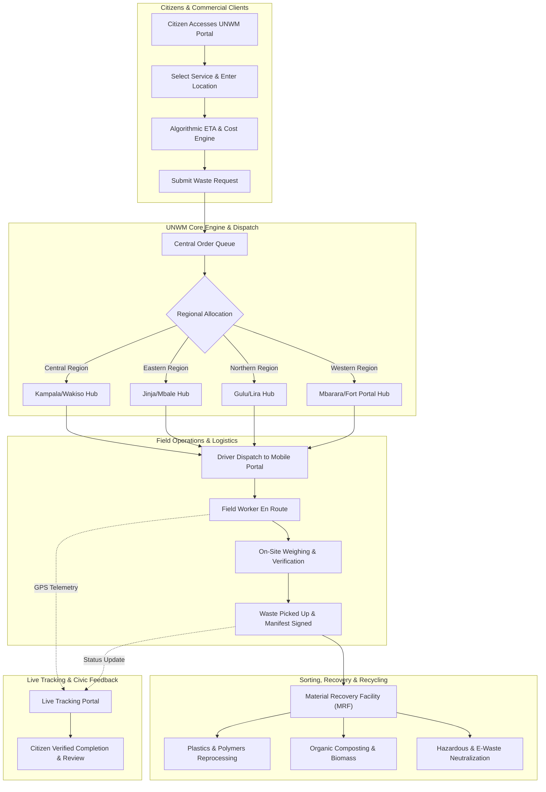

<p align="center">
  
</p>

<h1 align="center">Uganda National Waste Management (UNWM)</h1>

<p align="center">
  <strong>Clean Uganda, Green Future - Unified Digital Waste Logistics, Tracking, and Recycling Platform</strong>
</p>

<p align="center">
  <a href="#license"></a>
  <a href="#tech-stack"></a>
  <a href="#installation"></a>
  <a href="#system-workflow"></a>
  <a href="#features"></a>
</p>

---

## Table of Contents
- [Executive Overview](#executive-overview)
- [Problem Statement](#problem-statement)
- [The Solution](#the-solution)
- [System Architecture & Workflow](#system-architecture--workflow)
- [Tech Stack](#tech-stack)
- [Core Modules & Features](#core-modules--features)
- [User Roles & Portals](#user-roles--portals)
- [Project Directory Structure](#project-directory-structure)
- [Installation & Local Setup](#installation--local-setup)
- [Progressive Web App (PWA) Capabilities](#progressive-web-app-pwa-capabilities)
- [Environmental Impact & Regulatory Alignment](#environmental-impact--regulatory-alignment)
- [Contributing](#contributing)
- [License](#license)

---

## Executive Overview

The **Uganda National Waste Management (UNWM)** platform is an enterprise-grade, nation-scale digital municipal public utility system engineered to solve municipal solid waste, commercial collection, and recycling logistics across the Republic of Uganda.

Connecting Ugandan citizens, business operators, municipal authorities (such as KCCA and district urban councils), certified private waste collectors, and material recovery facilities, UNWM bridges the gap between waste generation and responsible, eco-certified recycling.

---

## Problem Statement

Rapid urbanization across Kampala Metropolitan, Wakiso, Mukono, Jinja, Gulu, and Mbarara has outpaced traditional manual waste collection systems:

1. **Severe Infrastructure Bottlenecks**: Over 28,000 metric tons of municipal solid waste are generated nationwide each month, with less than 40% entering certified disposal pipelines.
2. **Unregulated Dumping & Drainage Clogging**: Waste accumulation in roadside drainage systems leads to severe urban flooding and environmental hazards around Lake Victoria and the River Nile basin.
3. **Lack of Pickup Predictability**: Citizens lack transparency into truck arrival schedules, standard pricing tariffs, and certified collection routes.
4. **Data Silos**: District local governments have historically lacked centralized telemetry, making it difficult to allocate equipment, monitor contractor compliance, or track landfill divergence metrics.

---

## The Solution

UNWM digitizes Uganda's entire waste management supply chain into a single, intuitive, and offline-capable platform:

* **Algorithmic On-Demand Booking**: Citizens book residential, commercial, or hazardous pickups with instantaneous ETA estimation calculated from regional depot proximity.
* **Live GPS Fleet Tracking**: Real-time multi-stage visual tracking (`Booked` -> `Dispatched` -> `In Transit` -> `Collected` -> `Sorted` -> `Recycled`).
* **Nationwide District Coverage**: Comprehensive operational coverage across all 135+ districts categorized by Central, Eastern, Northern, and Western regions.
* **Offline-First Progressive Web App (PWA)**: Designed to function reliably on mobile networks with low bandwidth, intermittent connectivity, and offline caching.
* **Public Knowledge Engine**: 24/7 AI-guided conversational assistant for instant inquiries regarding waste categorization, local pricing, and eco-regulations.
* **Role-Based Portals**: Tailored interfaces for Citizens, Municipal Sanitation Field Crews, and Administrative Operations Managers.

---

## System Architecture & Workflow

The diagram below outlines the end-to-end lifecycle of a waste management request through the UNWM platform:



---

## Tech Stack

The UNWM platform is intentionally built with high-performance vanilla web standards to guarantee lightning-fast load times, zero build-step overhead, and compatibility with low-end mobile devices common across emerging markets.

| Layer | Technologies | Description |
| :--- | :--- | :--- |
| **Frontend Core** | HTML5 Semantic Architecture | Accessible, SEO-optimized markup structured for all screen sizes |
| **Design System** | Vanilla CSS3 (Custom Tokens) | Editorial design system featuring Obsidian dark mode, glassmorphism, and responsive geometry |
| **Typography** | Google Fonts | `Playfair Display` (Luxury serif display) and `Plus Jakarta Sans` (Crisp modern interface sans) |
| **Iconography** | Font Awesome 6.6.0 Pro & SVG | Scalable vector glyphs with dedicated brand fallbacks for high visual fidelity |
| **Client-Side Logic** | Vanilla ECMAScript (ES6+) | Native asynchronous DOM manipulation, reactive event delegation, and state caching |
| **Data Persistence** | Web Storage API (LocalStorage) | Resilient client-side state machine persisting bookings, user sessions, and worker telemetry |
| **Offline & PWA** | Service Worker API & Web Manifest | Background precaching, network-first document routing, and installable application shell |
| **Mapping & Tracking**| Custom Canvas & SVG Telemetry | Real-time interactive Uganda district map and truck route tracking visualizer |

---

## Core Modules & Features

### 1. Off-Canvas Luxury Side Navigation
* Slide-out navigation drawer with an obsidian background, circular UNWM emblem, and cyan-illuminated close button.
* Editorial serif link typography with contextual subtitles (e.g., *"135+ Municipalities"* for Districts, *"Instant ETA"* for Bookings).
* Integrated white pill call-to-action button and high-contrast squircle social media launcher (LinkedIn, X/Twitter, YouTube, WhatsApp).

### 2. Algorithmic Booking & Instant ETA
* Multi-tier volume selection: Small (1-2 bags), Medium (3-5 bags), Bulk (truckload), and Hazardous/Medical.
* Automatic ETA computation based on district geographic coordinates and depot load factors.
* Instant generation of unique reference tracking codes (e.g., `UG-KLA-8291`).

### 3. Real-Time Tracking Portal
* Visual step-by-step progress monitor showing truck dispatch, transit telemetry, and collection verification.
* Direct driver contact channel and digital waste manifest lookup.

### 4. Interactive District Directory
* Complete directory of all 135+ Ugandan districts grouped by region.
* Direct local contact phone numbers, operating hours, and primary depot coordinates.
* Live filter search with zero-latency client-side indexing.

### 5. 24/7 AI Knowledge Assistant
* Intelligent conversational chatbot pre-loaded with national waste handling protocols, pricing packages, and eco-guidelines.
* Zero external API dependencies, operating directly on client hardware with sub-millisecond response latency.

---

## User Roles & Portals

```
+-------------------------------------------------------------------+
|                        UNWM SYSTEM ACTORS                         |
+-------------------+-----------------------+-----------------------+
|  Citizen Client   |  Sanitation Worker    |  Operations Admin     |
+-------------------+-----------------------+-----------------------+
| - Book pickups    | - View route orders   | - System analytics    |
| - Live GPS track  | - Update status       | - Fleet allocation    |
| - Rate collectors | - Verify volume/weight| - District metrics    |
| - Learn & report  | - Report route issues | - Compliance reports  |
+-------------------+-----------------------+-----------------------+
```

1. **Citizen Portal** (`index.html`, `booking.html`, `track.html`, `profile.html`): Allows residents and business managers to request collections, view pickup history, and manage waste subscriptions.
2. **Sanitation Worker Dashboard** (`worker-dashboard.html`): Mobile-first operational portal for truck operators to accept pickup dispatches, navigate to addresses, and upload digital manifest confirmations.
3. **Administration Console** (`admin.html`): Central operational headquarters for municipal dispatch coordinators to analyze city-wide collection efficiency, manage regional pricing tariffs, and audit contractor metrics.

---

## Project Directory Structure

```
Clean-City-App/
├── assets/                          # Static media, vector graphics & logos
│   ├── logo.svg                     # Primary UNWM circular vector logo
│   ├── logo-192x192.png             # PWA standard app icon (192x192)
│   ├── logo-512x512.png             # PWA splash & store icon (512x512)
│   ├── favicon-32x32.png            # Web browser tab favicon
│   ├── waste-bins.jpg               # Hero slideshow photography
│   └── ...                          # High-resolution service photography
├── css/
│   └── style.css                    # Master design system & responsive rules
├── html/                            # Application page templates
│   ├── admin.html                   # Municipal administration console
│   ├── booking.html                 # Citizen waste booking portal
│   ├── contact.html                 # National support & district hotlines
│   ├── districts.html               # 135+ District directory & regional map
│   ├── feedback.html                # Public reviews & community voice
│   ├── learn.html                   # National waste education center
│   ├── login.html                   # Unified authentication login
│   ├── profile.html                 # Citizen user account dashboard
│   ├── register.html                # New client registration portal
│   ├── services.html                # Commercial, industrial & home services
│   ├── track.html                   # Real-time GPS order tracking portal
│   └── worker-dashboard.html        # Field collection team portal
├── js/
│   ├── script.js                    # Global application logic, nav & booking
│   └── chatbot.js                   # AI knowledge assistant & civic FAQ
├── index.html                       # Application landing page & home shell
├── manifest.json                    # W3C Web App Manifest specification
├── sw.js                            # Offline cache & Service Worker engine
├── LICENSE                          # MIT open-source license
└── README.md                        # Master system documentation
```

---

## Installation & Local Setup

The UNWM web application requires no compiler, bundler, or runtime compilation steps. It runs directly on any modern standards-compliant web browser.

### Option 1: VS Code Live Server (Recommended)
1. Clone or download the repository to your local workspace:
   ```bash
   git clone https://github.com/your-org/clean-city-app.git
   cd clean-city-app
   ```
2. Open the folder in **Visual Studio Code**.
3. Right-click on `index.html` and select **"Open with Live Server"**.
4. The application will launch at `http://127.0.0.1:5500/`.

### Option 2: Python Static Server
If Python is installed on your machine:
```bash
# Navigate to the repository root
cd Clean-City-App

# Start a local HTTP server
python -m http.server 8080
```
Open your browser and navigate to `http://localhost:8080/`.

### Option 3: Node.js (npx serve)
```bash
cd Clean-City-App
npx serve -l 8080 .
```

---

## Progressive Web App (PWA) Capabilities

UNWM is engineered as a fully compliant **Progressive Web App (PWA)**:

* **Installability**: Can be added directly to the home screen on Android, iOS, Windows 11, and macOS without app store intermediaries.
* **Offline Caching Engine**: Core stylesheets, scripts, typography, and visual assets are pre-cached on installation.
* **Network-First Document Strategy**: Guarantees that users always view the latest operational announcements while retaining complete offline functionality during network drops.
* **App Shortcuts**: Quick-action links configured in `manifest.json` for rapid navigation to *Book a Pickup*, *Track Collection*, and *Districts*.

---

## Environmental Impact & Regulatory Alignment

UNWM is architected to align with the statutory frameworks established by Ugandan environmental and municipal bodies:

* **National Environment Management Authority (NEMA)**: Conforms to the National Environment (Waste Management) Regulations for certified hazardous and medical disposal.
* **Kampala Capital City Authority (KCCA)**: Aligned with the Solid Waste Management Ordinance for city division route planning.
* **Ministry of Water and Environment**: Supports the national campaign against non-biodegradable polythene pollution (kavera) through source-segregation tracking.

---

## Contributing

We welcome community contributions, bug fixes, and feature enhancements to make Uganda cleaner and greener:

1. **Fork the Repository** on GitHub.
2. **Create a Feature Branch**:
   ```bash
   git checkout -b feature/improved-fleet-telemetry
   ```
3. **Commit Your Changes**:
   ```bash
   git commit -m "feat: enhance real-time fleet ETA calculations"
   ```
4. **Push to Your Branch**:
   ```bash
   git push origin feature/improved-fleet-telemetry
   ```
5. **Open a Pull Request** describing your additions and environmental impact.

---

## License

This project is open-source software licensed under the terms of the **MIT License**.

```
MIT License

Copyright (c) 2026 Uganda National Waste Management (UNWM) Initiative

Permission is hereby granted, free of charge, to any person obtaining a copy
of this software and associated documentation files (the "Software"), to deal
in the Software without restriction, including without limitation the rights
to use, copy, modify, merge, publish, distribute, sublicense, and/or sell
copies of the Software, and to permit persons to whom the Software is
furnished to do so, subject to the following conditions:

The above copyright notice and this permission notice shall be included in all
copies or substantial portions of the Software.

THE SOFTWARE IS PROVIDED "AS IS", WITHOUT WARRANTY OF ANY KIND, EXPRESS OR
IMPLIED, INCLUDING BUT NOT LIMITED TO THE WARRANTIES OF MERCHANTABILITY,
FITNESS FOR A PARTICULAR PURPOSE AND NONINFRINGEMENT. IN NO EVENT SHALL THE
AUTHORS OR COPYRIGHT HOLDERS BE LIABLE FOR ANY CLAIM, DAMAGES OR OTHER
LIABILITY, WHETHER IN AN ACTION OF CONTRACT, TORT OR OTHERWISE, ARISING FROM,
OUT OF OR IN CONNECTION WITH THE SOFTWARE OR THE USE OR OTHER DEALINGS IN THE
SOFTWARE.
```

---

<p align="center">
  <strong>Uganda National Waste Management (UNWM)</strong><br>
  <em>Clean Uganda, Green Future - Sustainable Logistics for Every Citizen.</em>
</p>
